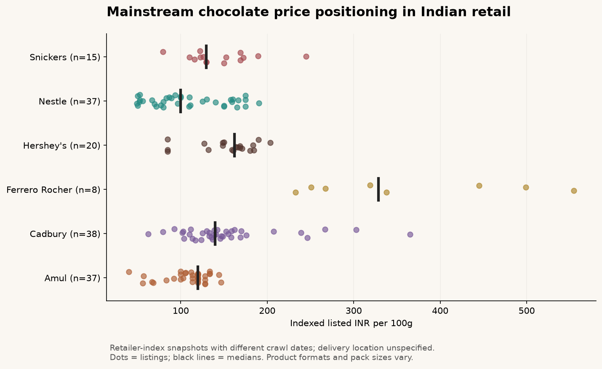
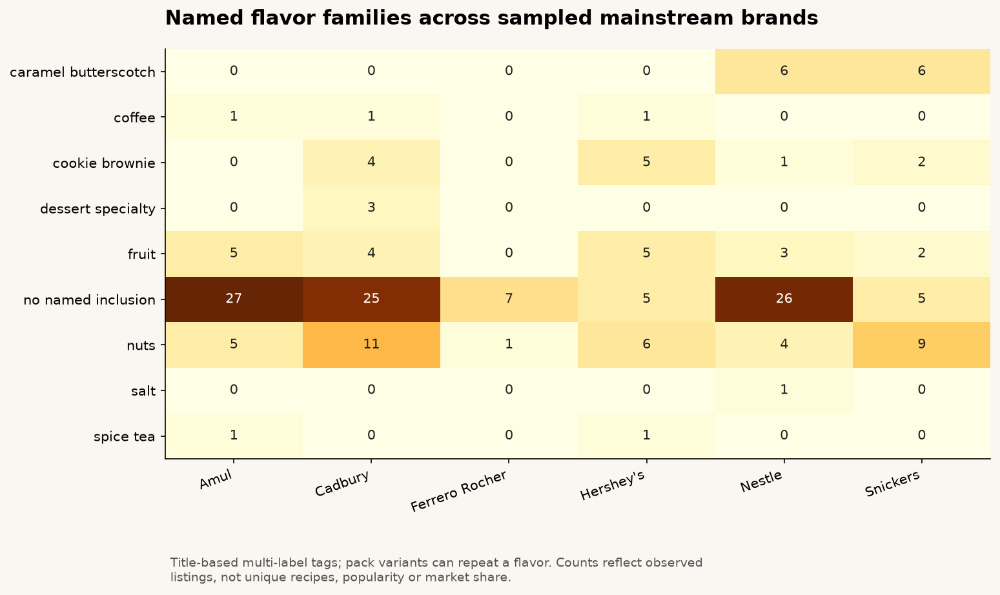
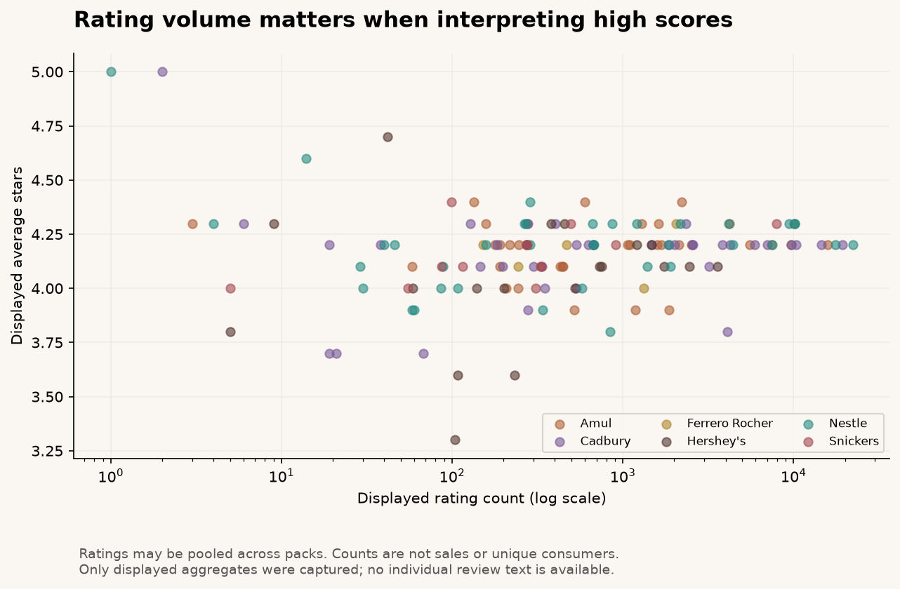
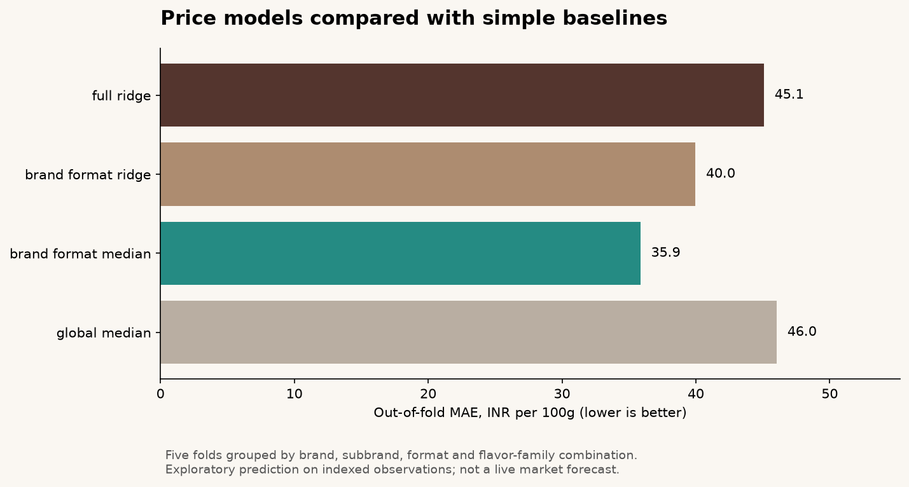

# Findings: mainstream chocolates sold in India

**161 retained retail listings; 155 priced listings; six mainstream brands; 148 listings with aggregate ratings.**

Sources were retrieved on 12 October 2026 from public retailer-index extracts. Their displayed crawl ages range from today to approximately three months; prices are not a synchronized live snapshot. The delivery location is unspecified. All comparisons are descriptive and specific to this sample.

## 1. An equal-pack flavor comparison: Amul

The sampled 150g Amul Dark Chocolate, Tropical Orange and Fruit N Nut cards each list INR 180 (INR 120/100g). In this matched example, those named inclusions do not carry a listed-price premium. This does not establish equal production cost, equal willingness to pay or unchanged prices elsewhere.

## 2. Separate brand, format and pack size

| Brand | Priced listings | Median INR/100g |
|---|---:|---:|
| Amul | 37 | 120.00 |
| Cadbury | 38 | 139.74 |
| Ferrero Rocher | 8 | 328.50 |
| Hershey's | 20 | 162.13 |
| Nestle | 37 | 100.00 |
| Snickers | 15 | 129.55 |

These medians mix formats and include assorted/gift packs. `03_brand_format_flavors.csv` compares flavors within brand and format; the model also controls for format. A separate evaluation excludes gift/assortment listings.

## 3. Flavor breadth is not demand

- nuts: 36 listings (22.4%).
- fruit: 19 listings (11.8%).
- cookie brownie: 12 listings (7.5%).
- caramel butterscotch: 12 listings (7.5%).
- dessert specialty: 3 listings (1.9%).
- coffee: 3 listings (1.9%).
- spice tea: 2 listings (1.2%).
- salt: 1 listings (0.6%).

Tags overlap and are derived from marketed titles. A flavor absent from a title can still be present in the ingredients. Multiple sizes can repeat a recipe. No national flavor popularity, sales share or market gap is inferred.

## 4. Customer rating evidence needs context

28 of 148 rated listings have fewer than 100 displayed ratings. The within-brand shrinkage table reduces the influence of tiny counts, with pseudo-count sensitivity at 20, 100 and 500. Counts may be shared across pack variants, so they are never summed as unique reviews or consumers. There are no individual reviews in this revised dataset; no sentiment or taste-versus-delivery claim is made.

## 5. Out-of-fold model comparison

Principal grouped MAE: **INR 35.85/100g** for the brand/format median baseline and **INR 45.08/100g** for full ridge regression.

The full model uses brand, format, pack mass, explicitly named cocoa percentage and flavor flags. Preprocessing is fit inside training folds. Related products stay in the same family group. Missing prices are never imputed into the target. The model uses fixed alpha=10, with no hyperparameter selection on test results.
See `model_metrics.csv` for leave-one-brand-out transfer, recent-source-only (approximate crawl age at most 30 days) and no-gift sensitivity results. Source recency and brand are confounded: excluding older pages drops Ferrero and Cadbury Silk. Bootstrap intervals resample fixed held-out errors by group; they are descriptive, not causal.

## Business actions supported by this evidence

- Benchmark same-weight and same-format products before interpreting flavor price differences.
- Use low-count ratings as research prompts; commission a representative consumer preference study before selecting a launch flavor.
- Validate candidate price comparisons against one delivery postcode and one collection date before a pricing decision.
- Expand to other retailers and actual sales outcomes before forecasting demand.

## Traceability

Every record in `data/observations.json` carries a source URL, source ID, original pack label and source-card position. `data/sources.json` records retrieval method and approximate crawl age. Seven SQL analyses, a model card, data dictionary, executed notebook and tests accompany this report.
